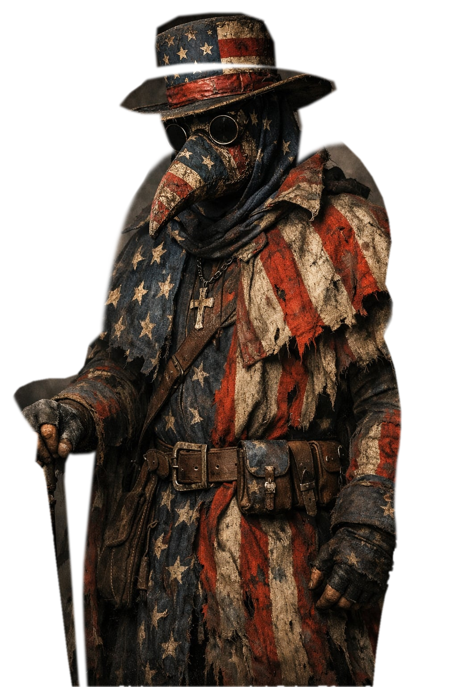

# Old Glory — a VTuber built from one picture

A single 1024×1536 illustration turned into a working, animated character:

- **`index.html`** — a zero-dependency browser rig. Cursor steers the head, microphone drives speech motion, and every part moves on its own spring so the cloth has weight.
- **`assets/model/old-glory.vrm`** — a VRM 1.0 avatar (glTF 2.0 + `VRMC_vrm`) with a real humanoid skeleton and per-part skinned cards, ready for VSeeFace, Warudo, Resonite, VirtualMotionCapture and friends.
- **`tools/`** — the build pipeline that produced both, so the model can be regenerated or re-cut.



## Run it

```bash
python3 -m http.server 8000
# or: npx serve .
```

Open <http://localhost:8000>. Nothing to install, no build step, no framework.

| Input | Action |
| --- | --- |
| Move the cursor | Head turns, hat and cape trail behind |
| Click **Mic** (`C`) | Microphone lip-sync / speech bounce |
| `M` | Cycle background: studio → black → green → blue → transparent |
| `H` | Hide the UI |
| Wheel | Zoom |
| `R` | Reset |

### URL options

```
?bg=green&ui=0          green screen, no controls
?bg=none                transparent — drop straight into OBS
?mirror=1               face the other way
?px=0.7&py=-0.3         hold a fixed pose (no pointer needed)
?demo=1                 synthetic talk motion, useful for testing
```

### OBS

Add a **Browser** source pointing at `http://localhost:8000/?bg=none&ui=0`, width 1024, height 1536, and tick *Shutdown source when not visible* off. Use `?bg=green` plus a chroma key if your setup prefers it.

> The mic needs a secure context: `localhost` counts, a LAN IP does not. Serve over HTTPS if you host it.

## The 3D export

`assets/model/old-glory.vrm` (and an identical `.glb`) is generated by `tools/build_vrm.py`.

The source is a flat painting, so the 3D rebuild is a **paper doll**: each layer is a textured card bound 100% to one humanoid bone (`head`, `chest`, `spine`, `leftLowerArm`, …). You get real head/arm/full-body tracking, correct depth ordering and a valid VRM that imports cleanly — but the geometry itself is flat, by nature of the source.

- Head tracking: the head, hat and scarf turn together around the neck.
- Above roughly ±35° of yaw the flatness starts to show, as it would on any cutout.
- Validation: Khronos `gltf-validator` reports 0 errors / 0 warnings, and the `VRMC_vrm` extension passes the official 1.0 JSON schema.

If you want a *fully modelled* character instead, the honest path is sculpting/retopologising in Blender or VRoid and re-rigging — a single image does not contain the information for a real mesh. The layered cutouts here are a fine base for that, or for a Live2D / Inochi2D rig.

## Rebuild / customise

```bash
python3 tools/build_layers.py   # cut assets/source/character.jpg into layers
python3 tools/build_vrm.py      # repack those layers into VRM 1.0
```

- `tools/masks.py` — the hand-authored cut lines, pivots and draw order.
- `tools/matte.py` — background removal. It models the smoky backdrop with a local interpolation of the pixels around the character, so no ML weights and no GPU are needed.
- `assets/rig.json` — generated layout: layer bounds, pivot points, z-order.

To use another picture: drop it in `assets/source/character.jpg`, adjust the polygons in `masks.py`, and run both build scripts. The web rig reads `rig.json`, so new layers appear with no code changes.

## Layout

```
index.html              the rig: canvas, controls
src/rig.js              springs, per-part motion, renderer
src/mic.js              microphone envelope with adaptive noise gate
src/main.js             asset loading, input, UI
src/spring.js           damped spring
assets/rig.json         layer layout + pivots
assets/layers/*.png     transparent cutouts
assets/model/*.vrm      VRM 1.0 / glTF export
assets/source/*.jpg     original illustration
tools/*.py              cut, matte, build
```

## License

Code: MIT. Character art and the derived model: CC BY 4.0 — credit "Old Glory by bhntr81".

The character is a plague-doctor design built on American flag motifs. It is a costume, not a statement; the VRM metadata allows political/religious use so you can do as you like with it.
